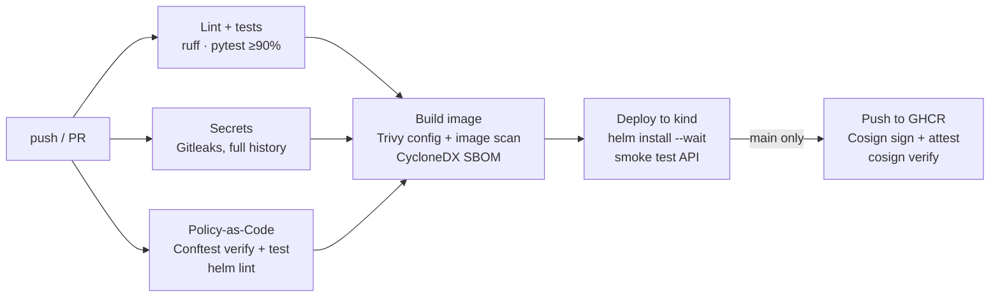

# DevSecOps pipeline on GitHub Actions

[](https://github.com/iyedboubakri12/devsecops-github-actions-pipeline/actions/workflows/pipeline.yml)

A complete, security-first CI/CD pipeline for a small Python API: every push is linted, tested, scanned for secrets, checked against Policy-as-Code, built into a hardened image, scanned for vulnerabilities, **deployed to a real Kubernetes cluster (kind) inside CI and smoke-tested**, then pushed to GHCR and **signed with Cosign (keyless, OIDC)** with an attached SBOM.

It is the GitHub Actions counterpart of my final-year project (a 13-stage GitLab CI pipeline on DigitalOcean Kubernetes), rebuilt from scratch so anyone can read the code and see every run.

## Pipeline



| Stage | Tools | Fails the build when |
|---|---|---|
| Lint + tests | Ruff (incl. Bandit-style `S` rules), pytest, pytest-cov | lint error, failing test, coverage < 90% |
| Secrets | Gitleaks (`gitleaks git`, every commit) | a secret is found anywhere in history |
| Policy-as-Code | OPA / Conftest, Helm lint | a manifest has no CPU/memory limits, runs as root, is privileged, has a writable root FS or uses `:latest` |
| Build + scan | Docker Buildx (GHA cache), Trivy | HIGH/CRITICAL misconfiguration, or a **fixable** CRITICAL CVE |
| Deploy | kind, Helm, kubectl | rollout not ready in 3 min, or API smoke test fails |
| Publish | GHCR, Cosign keyless, SBOM attestation | signing or signature verification fails |

The image pushed to GHCR is the **exact tarball that was scanned and deployed**, not a rebuild.

## Security choices

- **Image**: multi-stage build, `python:3.12-slim`, dependencies in a venv, runs as UID `10001`, no shell for the user.
- **Pod**: `runAsNonRoot`, `readOnlyRootFilesystem`, `allowPrivilegeEscalation: false`, all capabilities dropped, `seccompProfile: RuntimeDefault`, no service-account token, probes and resource limits.
- **Policies are tested**: `policy/deployment_test.rego` proves each rule rejects a bad manifest (`conftest verify`).
- **Least-privilege workflow**: `contents: read` by default; only the publish job gets `packages: write` and `id-token: write`.
- **Keyless signing**: no private key to store; the signature is bound to this repository's workflow identity.

Verify a published image yourself:

```bash
cosign verify ghcr.io/iyedboubakri12/inventory-api@<digest> \
  --certificate-identity-regexp '^https://github.com/iyedboubakri12/devsecops-github-actions-pipeline/' \
  --certificate-oidc-issuer https://token.actions.githubusercontent.com
```

## Run it locally

```bash
python -m venv .venv && . .venv/bin/activate
pip install -r requirements-dev.txt
ruff check . && pytest --cov=app
uvicorn app.main:app --reload --port 8080     # http://localhost:8080/docs

docker build -t inventory-api:dev .
conftest verify --policy policy
helm template demo charts/app --set image.tag=dev | conftest test - --policy policy
```

## Layout

```
app/                 FastAPI service (health, version, items CRUD)
tests/               pytest suite
Dockerfile           multi-stage, non-root
charts/app/          Helm chart (hardened Deployment + Service)
policy/              Rego policies + their unit tests
.github/workflows/   the pipeline
```

## What I would add next

- Argo CD pulling the chart from this repo into a real cluster (GitOps), as in my final-year project.
- An admission policy (Kyverno or Sigstore policy-controller) that only admits images signed by this workflow.
- DAST with OWASP ZAP against the kind deployment.
